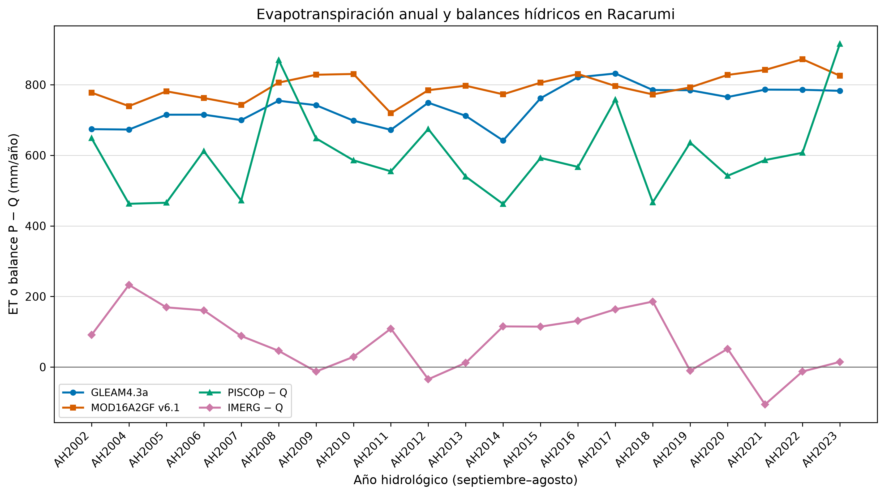
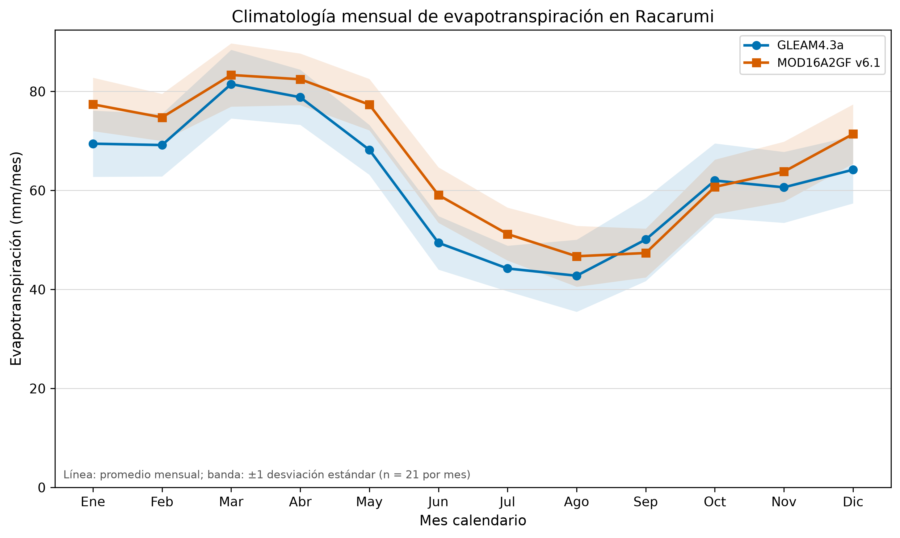

# 1.2.4. Productos independientes de evapotranspiración real

> Versión técnica preparada para el informe. La interpretación física y las conclusiones se reservan para la elaboración del informe final.

## Metodología

Se utilizaron dos productos de evapotranspiración real con formulaciones y resoluciones distintas: GLEAM4.3a y MOD16A2GF versión 6.1. La comparación se restringió a los 21 años hidrológicos completos del balance: AH 2002 y AH 2004–AH 2023, definidos de septiembre a agosto. Esta selección contiene 252 meses y excluye AH 2003, sin interpolación de datos.

GLEAM4.3a estima la evaporación terrestre a partir de componentes como transpiración, evaporación del suelo, pérdida por interceptación, sublimación y evaporación de agua abierta. GLEAM4 calcula la evaporación potencial mediante la ecuación de Penman y representa el estrés evaporativo con información de humedad del suelo, vegetación y demanda atmosférica; en GLEAM4.3 se incorporó una formulación XGBoost con restricciones físicas para la relación entre agua disponible para las plantas y estrés. El producto tiene resolución espacial de 0,1°. Para Racarumi se utilizaron los NetCDF mensuales de `E`, cuya unidad verificada es `mm.month-1`.

Los 23 NetCDF de 2001–2023 se validaron mediante tamaño, dimensiones, fechas, unidad, máscara `_FillValue = -999` y SHA-256. La delimitación original de Racarumi se intersectó con la grilla nativa de GLEAM. Las áreas se calcularon en EPSG:6933 y se obtuvieron 35 celdas con intersección positiva. La media mensual se ponderó por área; la cobertura válida fue 100 % para los 252 meses. Como `E` ya corresponde a un acumulado mensual, no se multiplicó por el número de días.

MOD16A2GF v6.1 es un producto de evapotranspiración gap-filled basado en la lógica de Penman–Monteith. Emplea reanálisis meteorológico diario y variables MODIS relacionadas con vegetación, albedo y cobertura del suelo. Su resolución nominal es 500 m y sus valores de ET representan acumulados por compuesto de ocho días; el último compuesto del año puede durar cinco o seis días. Para Racarumi se aplicó el factor de escala 0,1 y se calculó una media ponderada por el área válida en la proyección nativa. Se conservaron las métricas `ET_QC` sin imponer una máscara adicional no justificada. Los compuestos que cruzan límites mensuales se repartieron según los días de solapamiento, suponiendo distribución uniforme dentro del compuesto. La cobertura espacial mínima fue 99,863 %.

Los valores mensuales de ambos productos se sumaron entre septiembre y agosto para construir los años hidrológicos. Los balances `PISCOp − Q` e `IMERG − Q` se recuperaron directamente de los resultados validados del numeral 1.2.1 y solo se cruzaron por los mismos 21 años completos.

## Comparación anual

**Figura 1.** Series anuales de GLEAM4.3a, MOD16A2GF v6.1 y los balances `PISCOp − Q` e `IMERG − Q` para AH 2002 y AH 2004–AH 2023. Los balances `P − Q` no representan mediciones directas de evapotranspiración.

## Climatología mensual

**Figura 2.** Promedio mensual de GLEAM4.3a y MOD16A2GF v6.1 calculado con los 252 meses comunes. Las bandas muestran ±1 desviación estándar interanual; cada mes calendario contiene 21 observaciones.

## Estadísticos anuales

La desviación estándar se calculó como desviación muestral (`n − 1`). Todos los estadísticos utilizan los mismos 21 años hidrológicos.

| Serie | n | Promedio | Desviación estándar | Mínimo | Máximo |
|---|---:|---:|---:|---:|---:|
| GLEAM4.3a | 21 | 740,48 | 52,40 | 641,87 | 831,87 |
| MOD16A2GF v6.1 | 21 | 795,55 | 37,59 | 719,33 | 872,30 |
| PISCOp − Q | 21 | 603,17 | 124,47 | 461,94 | 915,97 |
| IMERG − Q | 21 | 73,11 | 85,91 | −106,05 | 232,78 |

Todos los valores están expresados en `mm/año`.

## Diferencias entre series

La diferencia porcentual se calculó como `|media A − media B| / |media B| × 100`, donde B es la serie de referencia indicada. La diferencia absoluta pareada es el promedio de `|A − B|` calculado año a año.

| Serie A | Serie B (referencia) | Diferencia entre medias | Diferencia relativa a B | Diferencia absoluta pareada |
|---|---|---:|---:|---:|
| GLEAM4.3a | MOD16A2GF v6.1 | 55,07 | 6,92 % | 59,64 |
| GLEAM4.3a | PISCOp − Q | 137,31 | 22,77 % | 161,01 |
| GLEAM4.3a | IMERG − Q | 667,37 | 912,78 % | 667,37 |
| MOD16A2GF v6.1 | PISCOp − Q | 192,38 | 31,90 % | 207,11 |
| MOD16A2GF v6.1 | IMERG − Q | 722,44 | 988,10 % | 722,44 |
| PISCOp − Q | IMERG − Q | 530,05 | 724,97 % | 530,05 |

Las diferencias están expresadas en `mm/año`. Los porcentajes elevados cuando IMERG − Q es la referencia deben leerse considerando que su media es pequeña; no constituyen por sí mismos una medida de precisión.

## Limitaciones metodológicas

La estimación `ET = P − Q` es una aproximación de largo plazo derivada del balance hídrico bajo el supuesto de cambio neto de almacenamiento despreciable (`ΔS ≈ 0`). Puede diferir de los productos de ET por incertidumbres en precipitación y caudal, cambios de almacenamiento y flujos no representados. Por ello, `P − Q` no se considera una medición directa de ET ni un valor verdadero absoluto. GLEAM y MOD16 son productos modelados y tampoco constituyen observaciones directas independientes; ambos dependen de insumos meteorológicos y satelitales, aunque sus estructuras, variables y resoluciones difieren.

## Referencias

- GLEAM. *Global Land Evaporation Amsterdam Model: datasets and model description*. https://www.gleam.eu/
- Miralles, D. G., Bonte, O., Koppa, A., et al. (2025). GLEAM4: global land evaporation and soil moisture dataset at 0.1° resolution from 1980 to near present. *Scientific Data, 12*, 416. https://doi.org/10.1038/s41597-025-04610-y
- MODIS Land Team (2021). *MOD16 User’s Guide, Collection 6.1*. NASA LP DAAC. https://lpdaac.usgs.gov/documents/931/MOD16_User_Guide_V61.pdf
- Google Earth Engine. *MOD16A2GF.061: Terra Net Evapotranspiration Gap-Filled 8-Day Global 500 m*. https://developers.google.com/earth-engine/datasets/catalog/MODIS_061_MOD16A2GF

## Archivos reproducibles

- `codigo/punto1/cierre_punto_1_2_4.py`: generación de figuras y tablas.
- `productos/punto1/punto_1_2_4_estadisticos_anuales.csv`: estadísticos anuales.
- `productos/punto1/punto_1_2_4_diferencias_entre_metodos.csv`: diferencias absolutas y porcentuales.
- `productos/punto1/punto_1_2_4_climatologia_mensual_gleam_mod16.csv`: climatología mensual.
- `productos/punto1/figuras/punto_1_2_4_series_anuales.png` y `.svg`: Figura 1.
- `productos/punto1/figuras/punto_1_2_4_climatologia_mensual.png` y `.svg`: Figura 2.
